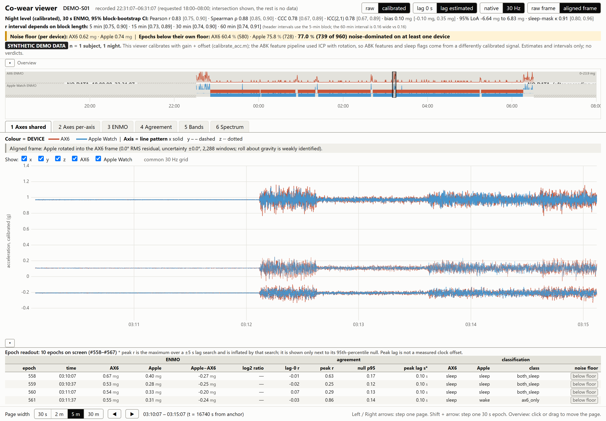
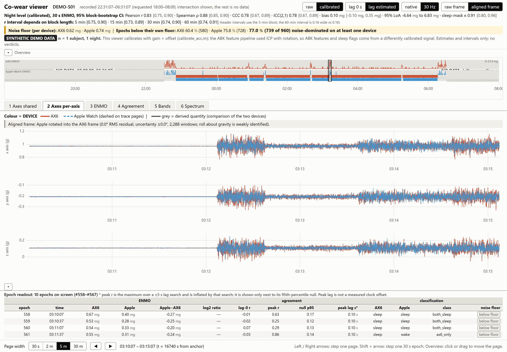
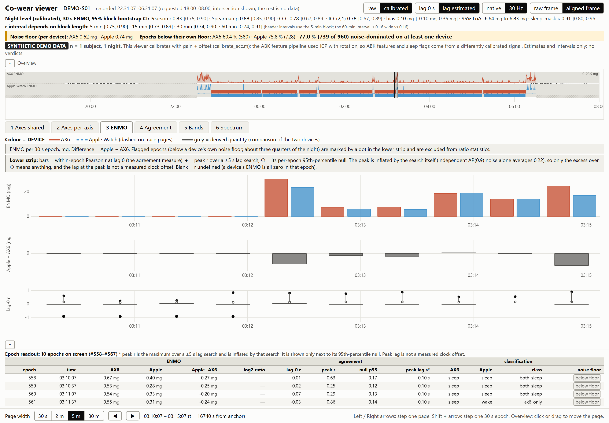
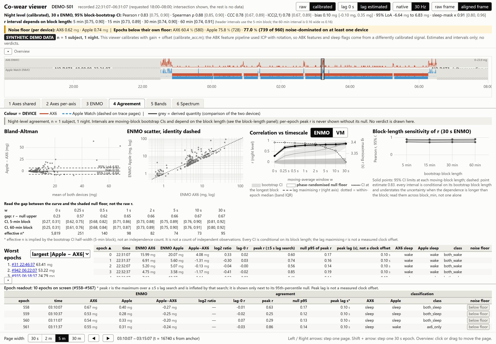
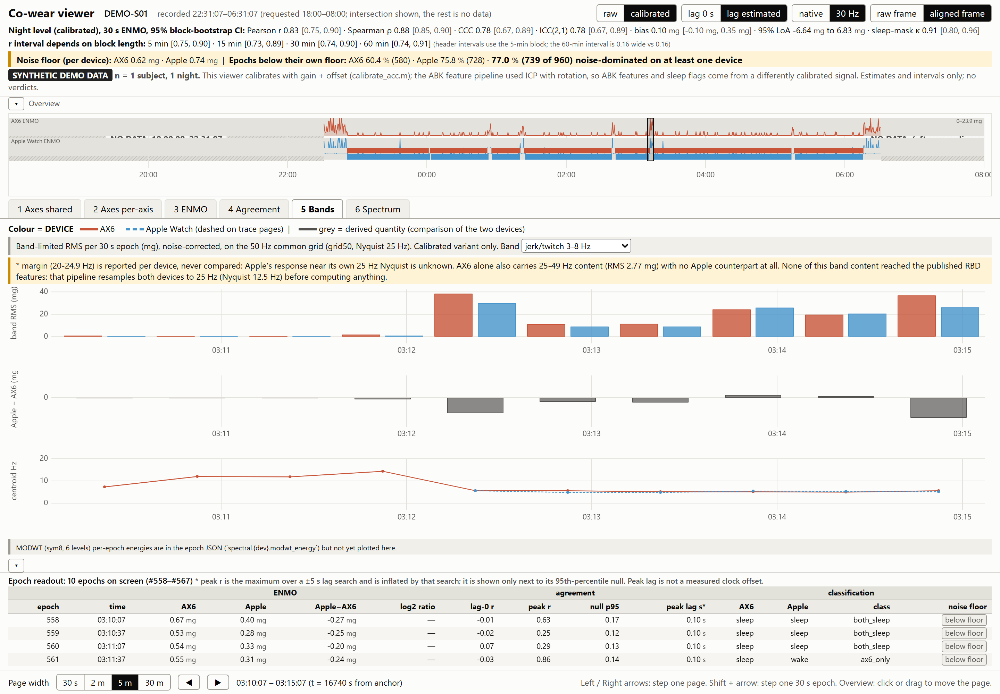
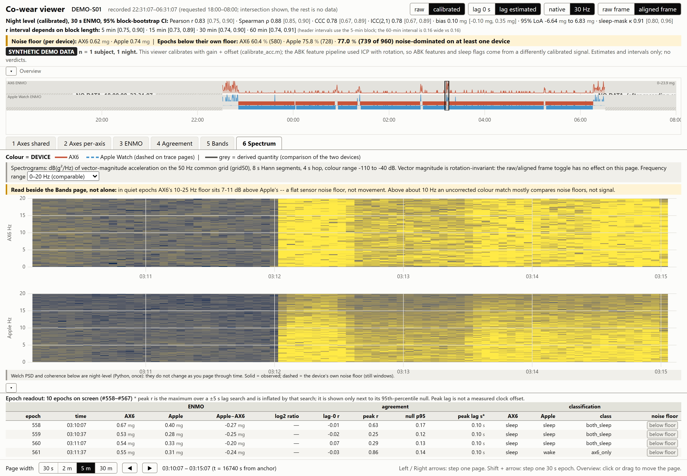

# Co-wear viewer

**Do two wrist accelerometers worn on the same night measure the same thing? This repo answers that sample by sample, epoch by epoch, and frequency band by frequency band, with honest error bars.**

This is a Python signal-processing pipeline and a zero-build browser viewer for comparing a research-grade
accelerometer (**Axivity AX6**, 100 Hz) with a consumer one (**Apple Watch**, ~50 Hz) worn together through a night.
It calibrates both devices, puts them on one clock and one coordinate frame, and scores their agreement at every
timescale from raw waveform to 30 s sleep epoch. Then it shows every step, so a reviewer can check the numbers
instead of trusting them.



---

## Motivation

Consumer wearables are moving into clinical research. Sleep, Parkinson's prodromes such as REM-sleep behaviour
disorder, and movement disorders are all candidates. The validation that would justify this is usually a single
correlation coefficient between the two devices' activity counts. That number hides almost everything that matters:

* **The devices don't share a clock.** A few seconds of drift is invisible in 30 s epochs but destroys any
  sample-level comparison.
* **They don't share a coordinate frame.** Each axis of one watch is not the same axis on the other device, and two
  wrists are not one wrist.
* **Neither device is calibrated out of the box.** Tens of mg of offset are common, and that is on the same order as
  the movements that matter during sleep.
* **Most of a night sits at the sensor noise floor.** Asleep, most epochs are dominated by the device's own noise. A
  ratio or correlation computed there measures the two noise floors, not the wearer.
* **The samples are serially dependent.** A naive bootstrap over 1 M samples gives confidence intervals that are far
  too narrow.
* **The devices see different frequency ranges.** The Apple Watch has nothing above 25 Hz, and the AX6's flat noise floor
  above ~12 Hz can look like extra movement.

This project treats each of these as a measurable quantity with its own diagnostic, not an assumption. It was built
for a sleep-research co-wear study. The study recordings are human-subject data and are **not** in this repository.
Everything here runs on a synthetic night instead (see [Demo data](#demo-data)).

## What it does

```
 AX6 .parquet ─┐                                                            ┌─ manifest.json   (provenance, calibration, lag, rotation)
               ├─ load ─ calibrate ─ lag ─ rotate ─ 30/50 Hz grid ─ stats ─┼─ epochs.json     (per-epoch ENMO, agreement, spectra)
Apple .parquet ┘   │        │         │       │          │              │   ├─ night.json      (night-level stats + bootstrap CIs)
 sleep bouts ──────┴────────┴─────────┴───────┴──────────┴──────────────┘   ├─ spectra.json    (PSD, coherence, bands)
                         quality gates (info / warn / fail) ───────────────►├─ quality.json + findings.csv
                                                                            └─ chunks/*.f32    (raw signal tiers for the viewer)
                                                                                        │
                                                         static HTML/JS viewer (uPlot) ◄┘  calibration, rotation and lag applied live
```

| Stage | Method | Module |
|---|---|---|
| **Timing repair** | Stable sort, exact-duplicate drop, nominal-rate detection from the median interval. Every repair is **counted**, never hidden. | `signals.load_recording` |
| **Calibration** | Per-axis gain + offset fitted on 10 s still windows until still-window means lie on the unit sphere (port of `calibrate_acc.m`, iterated to convergence), with orientation-coverage guards. | `calibration.py` |
| **Clock lag** | Cross-correlation of the band-passed (0.5–10 Hz) movement envelope of vector magnitude, which is rotation-invariant, over ±5 s. | `align.estimate_lag` |
| **Frame rotation** | Kabsch fit of paired gravity vectors from jointly still windows. Residual angle plus a block-bootstrap uncertainty, reported as fitted, not forced. | `align.fit_rotation` |
| **Common grid** | Interpolate to a uniform native-rate axis, then zero-phase polyphase decimation (`resample_poly`) to 30 Hz (agreement) and 50 Hz (spectral). Gaps > 1 s become NaN, never a ramp. | `signals.build_grid` |
| **ENMO / VM** | Computed at **native** rate *before* decimation, because ENMO is rectified and filtering changes it. | `signals.py` docstring |
| **Agreement** | Pearson, Spearman, Lin's CCC, ICC(2,1), Bland–Altman, sleep-mask Cohen's κ. Every interval is a **moving-block bootstrap**, reported at 5/15/30/60 min blocks, because each CI depends on its block length. | `agreement.py` |
| **Timescale sweep** | r vs moving-average window (0 s → 30 s) against a **phase-randomised null floor** (same spectrum, broken pairing) and the effective *n* implied by the CI. | `signals.ma_sweep` |
| **Noise floor** | Each device's own floor is measured from its still windows (σ<sub>VM</sub>/√(2π)). Epochs below it are flagged and kept out of ratio statistics, never silently dropped. | `signals.sensor_noise_floor` |
| **Within-epoch lag** | Peak r over a ±5 s search per epoch, always shown **beside its 95th-percentile null**, because the search itself inflates the peak. | `align.epoch_lags` |
| **Spectral** | Welch PSD, noise-PSD subtraction, magnitude-squared coherence with its bias floor, named band RMS (posture, gross movement, jerk/twitch, tremor), SEF95, centroid, spectral entropy, MODWT (sym8) level energies, and spectrograms. | `spectral.py` |
| **Quality gates** | Completeness, gap runs, rate error, jitter, reordering, gravity presence, calibration coverage, lag r, rotation residual. Each gives an info / warn / fail finding, and the findings decide which comparisons are allowed. | `preprocess/` |

## The viewer

A static page served from localhost: no build step, no framework, and one vendored plotting library
([uPlot](https://github.com/leeoniya/uPlot)). Python writes the artifacts, and the browser only draws. Calibration,
rotation and lag are applied in the browser from the manifest, so each one can be toggled to show what it changes.

| | |
|---|---|
|  |  |
| **Axes per-axis**: x/y/z in separate lanes, AX6 vs Apple in the aligned frame. | **ENMO**: both devices, their difference, and each device's own noise floor. |
|  |  |
| **Agreement**: Bland–Altman, log–log scatter, r vs timescale with null floor, block-length sensitivity, worst epochs. | **Bands**: noise-corrected band RMS per epoch, Apple − AX6 difference, spectral centroid. |



**Spectrum**: time-aligned dB spectrograms of both devices. These are paired with the night-level Welch PSD, each device's noise floor, and cross-device coherence.

Header toggles: **raw / calibrated**, **lag 0 / estimated**, **native / 30 Hz**, **raw / aligned frame**. Navigation:
click or drag the whole-night overview, or use ← / → (Shift steps one 30 s epoch).

## Install

Requires **Python ≥ 3.11** and any modern browser. There are no Node or JS dependencies.

```bash
git clone https://github.com/GiorgioRicciardiello/cowear-viewer.git
cd cowear-viewer
python -m venv .venv
# Windows: .venv\Scripts\activate    macOS/Linux: source .venv/bin/activate
pip install -e ".[dev]"
```

Python dependencies: `numpy`, `scipy`, `pandas`, `pyarrow`, `PyWavelets`, `PyYAML` (plus `pytest` for the tests).

## Quick start

```bash
python scripts/make_demo_data.py    # ~5 s   : writes a synthetic 8 h co-wear night to data/demo/
python scripts/build_viewer.py      # ~4 min : runs the full signal chain, writes data/ax6apple/viewer/
python scripts/run_viewer.py        # serves on http://127.0.0.1:8765 and opens the browser
```

Run the tests with:

```bash
pytest            # 194 fast tests: synthetic signals with known answers
```

## Demo data

`scripts/make_demo_data.py` generates a night with a known ground truth and plants each problem the pipeline is
built to fix. The build then has to recover the planted values blind. On the shipped seed:

| Planted | Truth | Recovered by the pipeline |
|---|---|---|
| AX6 offsets (mg) | −37.5, +52.4, −5.1 | −37.49, +52.40, −5.10 |
| AX6 gains | 1.004, 0.991, 0.998 | 1.004, 0.991, 0.998 |
| Apple offsets (mg) | −0.5, +2.5, −4.0 | −0.49, +2.49, −4.01 |
| Apple mounting frame | 35° rotation | recovered to 0.0004° |
| Apple clock ahead by | 3.4 s | 3.30 s (1 s envelope bins) |
| Apple rows swapped / duplicated | 40 / 12 | 52 backward steps counted, 12 duplicates dropped |
| Apple sample rate | 50.24 Hz, 2.6 % jitter | nominal 50 Hz, rate error flagged at info level |

Each wrist also gets its own movement on top of shared whole-body movement. Night-level 30 s ENMO agreement
therefore lands at a realistic **r = 0.83 [0.75, 0.90]** rather than 1.0, and 77 % of epochs fall below at least one
device's noise floor, as in real sleep.

## Using your own recordings

1. Export each device to Parquet with columns `time` (naive datetime), `x`, `y`, `z` (g), plus a `<file>.parquet.json`
   sidecar with `source_sha256` (and optionally `source_relative_path`).
2. Provide each device's sleep bouts as CSV (`annotation_start`, `annotation_end`, on the 30 s grid from the recording start).
3. Copy `config/config.yaml`, point `preprocessed_root`, `sleep_root`, `sources` and `variants` at your files, and run
   with `COWEAR_CONFIG=path/to/your.yaml`.

Real recordings are identifiable human-subject data. `run_viewer.py` binds `127.0.0.1` only, and `.gitignore`
excludes `data/`, `*.parquet` and `*.f32`.

## Repository layout

```
config/config.yaml        every path and analysis parameter (no magic numbers in code)
scripts/                  make_demo_data.py · build_viewer.py · run_viewer.py
src/ax6apple/             calibration · align · signals · agreement · spectral · viewer_export
src/ax6apple/preprocess/  data-quality gates: preflight, completeness, verdict, report
viewer/                   static HTML/JS viewer (uPlot vendored)
tests/                    pytest suite (fast synthetic tests; `slow` = private-data regression anchors)
docs/                     METHODS.md, screenshots
```

See **[docs/METHODS.md](docs/METHODS.md)** for the design decisions and the reasoning behind each one.

## Design principles

* **Estimates and intervals, no verdicts.** With n = 1 night there is no population to test against, so nothing
  returns a p-value or a pass/fail.
* **Flag, never drop.** Noise-floor epochs, timing repairs and gaps are counted and shown.
* **Every correlation sits beside its null.** This applies to lag-search peaks, timescale sweeps and coherence.
* **The browser only draws.** All statistics are computed once in Python, and the viewer cannot drift from the analysis.
* **The build is atomic.** Output is written to a `.partial` directory and swapped in only on success.

## License

MIT. See [LICENSE](LICENSE).
